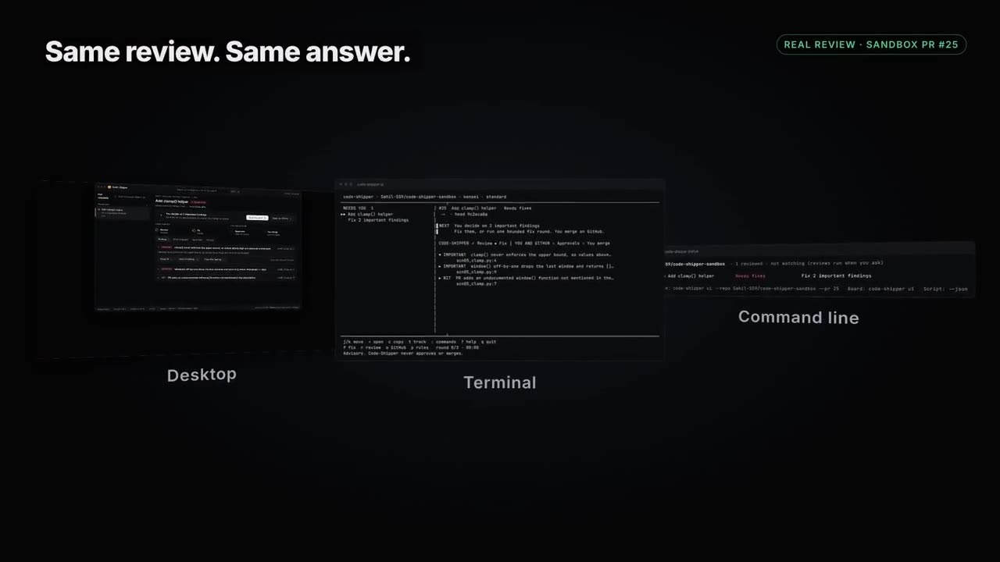

# Code-Shipper

Review, fix and get pull requests ready to merge, with any agent harness. Hermes Agent first.

Status: **v1, GitHub only, Linux tested.** Built and exercised end to end against a sandbox repository
(`Sahil-SS9/code-shipper-sandbox`). Code-Shipper exposes no merge action on any surface, and that is
asserted by tests rather than promised by documentation. Design and build records are in `docs/`.

[](docs/media/code-shipper-demo.mp4)

*60-second demo. Green tag = a real review of sandbox PR #25; amber tag = built-in sample data.
(Recorded before a fix: the header showed the builder's agent name instead of your profile.)*

Code-Shipper is an open-source take on the workflow Anthropic calls Claude Ship, built to work
across agent harnesses (Hermes, Claude Code, Codex, OpenCode, or a direct model API):

- **Review**: several lenses read the change, a verification pass tries to refute each finding,
  and only confirmed findings are posted inline. A review never approves or blocks.
- **Steward**: fixes failing checks, merge conflicts and review comments, posts what it changed
  and how to undo it after every push, and stops on `@code-shipper stop`. It never holds a GitHub
  credential, every write goes through a broker whose allowlist has no merge operation, and no
  surface offers a merge button. A person merges.
- **Approvals**: a policy file in your repo (`.code-shipper/approvals.yml`) says how many people
  must approve which paths. Observe mode first. Letting the agent approve low-risk changes is an
  opt-in flag, off by default, and needs a separate approver identity.
- **Triggers**: `/ship` (or `code-shipper ship`) on your current change, or opt-in polling of
  chosen pull requests while you run it.

**Polling, precisely.** There are no webhooks in v1 and no public endpoint. When you start a
watcher it checks each pull request **once every N seconds** (30 by default) for a new head, and
does nothing between checks. It is not a continuous stream, it does not react instantly, and a push
made one second after a check is seen on the next one. The watcher stops itself at a deadline you
set, on `@code-shipper stop`, or when you remove the stop label — and it checks those signals at the
start of every round, never mid-round.

GitHub only in v1; other code hosts come later through the same interface.

Safety note: the process running the model never gets a GitHub token, and every write goes through
a broker with a per-role allowlist and an exact-head check. Merging is a product constraint: no
surface exposes it. That is not the same as the token being harmless — a Contents-write token can
merge a pull request on an unprotected repository, which is why repos that enable agent approval
need branch rules or a ruleset as the last layer. On your own machine, a fix run that is not
contained can still read your own GitHub login from disk by absolute path; that is why fixing runs
happen in a container with credential files and sockets hidden, and why agent approval is refused unless
the platform doctor reports that container VERIFIED. What is measured is the container basics
(twenty controls, `docs/reports/M0-ROOTLESS.md`); a contained harness run with the host inference
broker is UNVERIFIED, so secure fixing is not yet proven. Details: `docs/tech-spec.md` §2.4, §6.1.

## Install

Requires Python 3.11 or newer. No third-party dependencies: the runtime is the standard library only.

```bash
git clone https://github.com/Sahil-SS9/code-shipper
cd code-shipper
python3 -m code_shipper.cli --help
```

There is nothing to install. `python3 -m code_shipper.cli` is the whole entry point; a wrapper script or a
`pip install -e .` is optional.

## First review

Everything below was run as written, in this order, on a fresh clone with no GitHub token set. The output is
quoted, not paraphrased.

**What you need:** Python 3.11 or newer, and one working agent harness. For Hermes, that means
`hermes chat` answers.

You also need read access to the repository, even for `--dry-run`: a review reads the pull request, and the
public sandbox is readable without a token. On a private repository, set `CODE_SHIPPER_GITHUB_TOKEN` or
place a token at `~/.config/code-shipper/tokens/fixer`. To *post* a review the token needs Issues: write on
that repository.

**Which AI it uses.** Your default Hermes model, unless you pass `--hermes-profile NAME` or
`--harness`. It costs whatever that model costs — Code-Shipper does not meter spend and cannot tell you a
figure. Every review summary names the harness, profile and model that actually ran:

```
harness: hermes · profile: (default) · model: claude-opus-5-5 · provider: anthropic
```

An unknown model is explained, not guessed. A throwaway `HERMES_HOME` must sit outside `~/.hermes`:
Hermes treats a home inside it as your main setup and answers with that setup's model, and Code-Shipper warns.

**1. Check the machine.**

```
$ python3 -m code_shipper.cli doctor
container backends:
  docker-rootless: VERIFIED
  bubblewrap: UNVERIFIED
```

UNVERIFIED is not an error. It means the backend is present but its controls have not been measured here, so
nothing depends on it.

**2. Review something, without posting.**

```
$ python3 -m code_shipper.cli review 25 --repo Sahil-SS9/code-shipper-sandbox --level quick --dry-run
```

On the public sandbox this reports two real defects and exits **1**:

```
Merge risk: elevated — 2 important finding(s) open.

  [important] scn05_clamp.py:4 clamp() never applies the high bound, so values above high come back unchanged
  [important] scn05_clamp.py:9 window() off-by-one drops the last window and returns [] when len(values) == size
```

Exit codes: **0** clean, **1** findings, **2** usage or setup error, **3** review incomplete (a partial
review is not a pass).

Two things that surprise people on a second run, both correct:

- **A re-run on a head already reviewed is cached** (`cached: this head was already reviewed…`) and exits
  **0**, because no *new* findings were recorded. `--no-cache` forces a fresh pass.
- **The exit code describes this run, not the pull request.** `important open across the whole PR: 2` is the
  line that tells you the PR state.

**3. Post for real.** Drop `--dry-run` and add a token that can comment on the repository:

```
$ export GITHUB_TOKEN=...        # a fine-grained token with Issues: write on that repo
$ python3 -m code_shipper.cli watch <pr> --repo owner/name
```

`watch` is the posting path. `review` computes and stores; it does not comment on GitHub, and says so.
Nothing ever approves and nothing ever merges — on any surface, including the API behind the plugin.

**4. See the board.**

```
$ python3 -m code_shipper.cli ui 25
```

With no terminal attached it prints plain text and no escape codes, which is what makes it safe in CI logs.

**5. Use it from Hermes.**

The plugin ships in `plugin/code-shipper` and validates against the installed Hermes:

```
$ hermes plugins validate plugin/code-shipper
✓ manifest — plugin.yaml parses
✓ manifest fields — name, version, description present
✓ loadable — entry: __init__.py
✓ declared tools — matches registrations
```

Install it from the repository URL, then restart the gateway and use `/ship` in a session:

```
$ hermes plugins install https://github.com/Sahil-SS9/code-shipper --enable
```

It is the same code on the same state directory as the CLI: a review started from either is visible from
both.

Run it from a checkout **outside** any credential directory. Code-Shipper refuses to mount `~/.ssh`,
`~/.aws`, `~/.hermes/auth` and similar into a worker, and the error names the path and suggests
`~/repos/<name>`. A checkout under `~/.hermes/repos/` is fine — only the credential locations are refused.

### Windows

The CLI runs under PowerShell. There is no `./` prefix:

```powershell
py -3 -m code_shipper.cli status
```

For the full local gate run (the same checks the GitHub matrix would run):

```powershell
bash scripts/local-ci.sh
```

`local-ci.sh` needs a POSIX shell — Git for Windows provides one. Without it, run the suite directly:

```powershell
py -3 -m unittest discover -s tests -t . -q
```

### Platforms tested

| Platform | Unit tests | A real contained fix run |
|---|---|---|
| Linux | **yes** — 1583 tests, 3.11 / 3.12 / 3.13, run locally | yes |
| macOS | **last passed on CI at `ccfbefa`; untested since** | no |
| Windows | **last passed on CI at `ccfbefa`; untested since** | no |

Read that table carefully. "Last passed on CI at `ccfbefa`" is not "passes today": no CI run has completed
since that commit, because the account's GitHub Actions billing is blocked. Every commit after it has been
verified on Linux only.

To get a real answer on your own machine, run one of these:

```bash
scripts/local-ci.sh              # macOS / Linux, all gates, 3.11–3.13
py -3 -m unittest discover -s tests -t . -q    # Windows, the suite alone
```

Containment — the container, the socket, the uid, the volume mounts — has only ever been exercised on
Linux. Do not assume a fix run works on macOS or Windows until it has been tried.

## Local checks

`scripts/local-ci.sh` runs the same gates as the GitHub matrix — portable syntax on 3.11/3.12/3.13, the
full suite on each, a clean-import check, and a seal check — and prints a PASS/FAIL line per gate. It exits
non-zero if any gate fails **or if a gate could not run at all**: a skipped gate is not a green tick.

```bash
scripts/local-ci.sh              # everything
scripts/local-ci.sh --only tests # one gate
```

## Exit codes

Every command that reports a review result uses the same four codes, so a wrapper can branch on them:

| Code | Meaning |
|---|---|
| `0` | **clean** — the review completed and found nothing to fix |
| `1` | **findings** — the review completed and found something to fix |
| `2` | **error** — the run failed; nothing was reviewed |
| `3` | **incomplete** — the review did not finish; this is not a clean result |

`3` is deliberately distinct from `2`. An incomplete review is not a tool failure and it is not a clean
result: it can be retried, and treating it as either success or error would be wrong in opposite
directions. `code-shipper --help` prints the same list.

## Protect your default branch

**Do this before you let Code-Shipper fix anything on a repository you care about.**

A token that can write contents can reach the merge endpoint. GitHub's branch protection gates the
*PR* — its approvals and its required checks — not the identity of whoever presses merge. So if the
PR is eligible, a write-capable token can merge it, and Code-Shipper assumes exactly that rather than
hoping otherwise.

Two rules:

1. **Protect your default branch.** Require a pull request, require at least one approval from
   someone other than the author, require the checks you rely on, and do not leave an admin bypass in
   place for the account whose token Code-Shipper uses.
2. **Never give the agent a merge-capable token.** Code-Shipper is built so it cannot leak one — the
   broker holds the token outside the container, the agent never sees it, and there is no merge
   operation anywhere in the product. Do not undo that by exporting a token into the environment the
   agent runs in, or by mounting one into its container.

The defence does not rely on a token being unable to merge. It relies on the token never reaching the
agent, and on your branch rules deciding what happens if one ever did.

Surfaces: a scriptable CLI, a terminal board and a Hermes Desktop page share one state and action
service. All three read the **stored review state** for a pull request — the same state `review`, `poll`
and `watch` write. Nothing draws sample data unless you ask for it with `--demo`, and then every surface
prints "demo data" on the output.

```
code-shipper status                          # everything reviewed, from stored state
code-shipper status --repo owner/name        # one repository
code-shipper ui --repo owner/name --pr 25    # the terminal board for a real review
code-shipper ship-page --repo owner/name --pr 25 --out board.html
code-shipper status --demo                   # the sample board, labelled as such
```

Inside Hermes the plugin provides `/ship <owner/repo> <pr> <subcommand>`, a thin wrapper over the CLI:
`review`, `board`, `fix`, `stop`, `status`, `publish`. `/ship ... board` draws the stored review;
there is no separate Hermes Desktop panel — the desktop surface is the HTML page `ship-page` writes, or
the terminal board. That is a deliberate scope line, not an omission: a second UI inside the Hermes
desktop would be a second place holding presentation logic.

`code-shipper review` reviews and **stores** the result without commenting on GitHub; `watch` and `poll`
are the posting path and post the same review. `code-shipper fix` without `--dry-run` prints the plan and
directs you to `watch`, which owns the round, the budget and the stop signal rather than duplicating them.

Roadmap: [`ROADMAP.md`](ROADMAP.md) — what ships, and why merging, approving and a Desktop panel are
deliberate non-goals rather than gaps.

Related work: Claude Ship (Anthropic, Claude-only) and
[diaktoros](https://github.com/coe0718/diaktoros) (Hermes-only review loop whose broker design
informs ours; it already has a host-side `human_paths` gate and experimental native macOS, so what
we add is the repository-committed policy with seats and observe/enforce). See
`docs/research/prior-art.md`.

## Rolling it out

Code-Shipper is advisory: it never merges, you merge on GitHub. These steps are what make it useful on a real team.

1. **Watch first, enforce later.** Leave the approval rules in observe mode for one to two weeks. Then
   run `code-shipper approvals report --repo owner/name --since 14d` and actually read it. Fix the
   "policy satisfied, reviewers asked for changes" rows first: those are the rules that are too loose.
2. **Write rules down slowly.** Add a line to `.code-shipper/REVIEW.md` only after the same comment has
   come up on at least two pull requests. Have a person approve it. Delete rules that no longer apply.
3. **Make the check required.** Unless the Code-Shipper check is required in branch protection, it is
   only advice.
4. **Watch out for auto-merge.** If auto-merge is on, a fix push can be the thing that lets GitHub
   merge. Decide which paths that is acceptable for.
5. **Trust the people who can change the base branch.** Fixes run in a container, but anyone who can
   push to the base branch decides which tests run. Use it on repositories where you trust them.
6. **Keep your other safeguards.** It can miss bugs and security problems. Keep your tests, scanners and
   human reviewers.

Files a repository can keep, all read from the **default branch**, never from the pull request:

| File | What it does |
|------|--------------|
| `.code-shipper/REVIEW.md` | What matters here and what to always check. `AGENTS.md` and `CLAUDE.md` are read too. |
| `.code-shipper/STEWARD.md` | House rules for fixes, such as "regenerate the lockfile, don't hand-edit it". |
| `.code-shipper/VERIFY.md` | How to start the app and test a change. Each fix reports what it ran and what it saw. |

These files guide the agent but cannot loosen any limit. Fixes can never edit CI, `CODEOWNERS`,
`.code-shipper/`, agent instructions, git hooks or anything that looks like a secret, whatever the config
says. A fix gets three tries per problem. After that, Code-Shipper stops and lists what it tried.

Before you push, `code-shipper review --local` reviews your branch and uncommitted changes. It needs no
token and posts nothing. Add `--apply` to fix Important findings in the contained worker: only files
your change already touches may be edited, and nothing is staged, committed or pushed. Comments from other bots are ignored unless you name the bot with
`--trust-bot NAME`. Even then they are claims to check, never instructions.

## Documents

| File | What it holds |
|------|---------------|
| `docs/HANDOFF.md` | Start here if you are building it |
| `docs/decisions.md` | Owner decisions (binding), research facts, proposed defaults |
| `docs/prd.md` | Problem, users, requirements, metrics, risks |
| `docs/architecture.md` | C4 diagrams, flows, trust boundaries |
| `docs/tech-spec.md` | Interfaces, numbers, policy grammar, broker, tests |
| `docs/build-plan.md` | Phases, gates, report template |
| `docs/REVISION-2.md` | Revision 2 body, retained as audit trail (folded into the docs above) |
| `docs/reports/` | Spike evidence, including the rootless containment probe |
| `docs/adr/` | Architecture decision records |
| `docs/research/` | Prior art and verified host surfaces |

## Tests

```
./scripts/run_tests.sh          # unit tests: fast, no Docker, no network
./scripts/run_tests.sh --full   # plus the contained-run battery (rootless Docker, cached image)
```

Standard library `unittest`; the runtime has no third-party dependencies.

Licence: MIT (see `LICENSE`).

